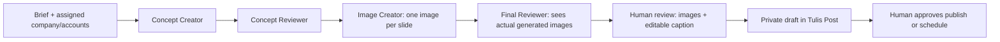

# Sosmed Generator

Integrated application: **https://lrmsosmed.playgo.id/#/generator**, under **Operasional → Sosmed Generator**. Developed on `sosmed-generator` and merged into `main` for the existing deployment pipeline. It uses the same application, user sessions, companies, accounts, SQLite database, media storage and Tulis Post approval flow.

## Workflow

1. Open the provider/agent settings. Save your own OpenAI, Anthropic and/or Gemini API keys. Keys are encrypted using the existing LRMsmm AES-256-GCM key; no key values are returned by the API. The Owner cannot retrieve another member's provider key through this feature. The existing server administrator and backup threat model still applies.
2. Choose provider, model ID and instructions per role. Text/review roles support OpenAI, Anthropic and Gemini. Image Creator supports OpenAI or Gemini; Claude has no image generation API. One provider can supply all supported stages; no need to subscribe to all three. Defaults are editable model IDs, not a guarantee of access or model availability. Connection tests verify a text model only.
3. Enter the campaign brief: brand, audience, objective, verified product facts, tone, colors, CTA and prohibited claims. Select assigned accounts (optionally filter company), 1–10 slides, and an optional proposed schedule.
4. Confirm API usage, then start. Three text/vision calls plus one image-generation call per slide are expected on a successful run. Final visual review sends resized copies of the actual images to the selected reviewer provider. Prompts/briefs and assets are shared with the chosen providers under their terms; chat-app subscriptions are separate from API billing.
5. View the durable results of each stage, including token usage metadata where returned. Inspect the feed preview, navigate carousel slides and edit the final caption. AI review is advisory, never publication approval.
6. Click **Kirim ke Tulis Post**. The app creates an own-user private draft with ready media, caption, destinations and proposed schedule. The scheduled date does not become active until the human approves in Tulis Post.

The generator currently creates still-image feed/carousel campaigns, not AI-generated videos, automatic video editing, autonomous open-ended agent teams, or a general-purpose workflow editor. The existing uploader/API still accepts video. Each role is a bounded LLM task with explicit input/output, rather than a shell-enabled coding agent. Images share campaign prompts; exact visual identity/text rendering is not guaranteed across slides. Use human review.

## Reliability and access

- Persistent SQLite runs with config snapshots, stage outputs, generated media IDs and states: queued → running → review → drafted; failed/cancelled are explicit.
- Maximum two running jobs overall and one per user. Maximum ten active queued/running/review campaigns per user and ten slides per campaign. No automatic paid retries or indefinite agent loops. These are call-count bounds, not a currency spending cap.
- A failed stage can be retried explicitly. Successful stages/slides remain intact. A call interrupted before its result is saved can be billed again on retry. Cancel prevents later stages/results from being committed; an already dispatched provider call may still be billed.
- After a worker crash, a stale running job becomes failed after ten minutes and requires manual retry. Queued jobs resume when the worker ticks. Existing app's single-process SQLite deployment constraint remains.
- Scope is checked at creation, between expensive calls, when displaying results and on handoff. Company/account access uses existing live assignments, including role changes. A creator can still cancel their own inaccessible run after access is revoked.
- Personal settings and keys require a dashboard session. Machine tokens cannot read/modify keys or launch paid generator work. External agents continue to use `/v1/agent/drafts` or the authenticated publishing API; these flows are separate.
- Pending/review/failed generator assets are retained for review/retry. After handoff the ordinary private draft/post retention applies; published files are removed when every use finishes. Cancelled orphan files follow existing garbage collection. Backups follow the existing backup policy.
- Provider endpoints are fixed official HTTPS origins, with timeouts and bounded response sizes. API credentials are sent only to their respective provider; raw provider errors are not exposed or logged. No provider tools, arbitrary shell execution, browser scraping, subscription-cookie extraction or hidden fallback providers.

## Implementation

- `src/llm/providers.js`: OpenAI chat completions + image generation, Anthropic messages + vision, Gemini generateContent text/vision/images.
- `src/services/generator.js`: personal settings, credentials, run state, execution and draft handoff.
- `/v1/generator/settings`, `/keys/{provider}`, `/keys/{provider}/test`, `/runs`, `/runs/{id}`, `/runs/{id}/retry`, `/runs/{id}/draft`: dashboard-session routes.
- Worker runs queue every normal publisher interval; new run/retry also kicks the queue immediately.

Provider model references (confirm availability against your account):

- https://platform.openai.com/docs/guides/image-generation
- https://platform.openai.com/docs/api-reference/chat/create
- https://docs.anthropic.com/en/api/messages
- https://ai.google.dev/gemini-api/docs/image-generation

## GitHub references researched

| Project | Relevant ideas | Decision |
| --- | --- | --- |
| [Paperclip](https://github.com/paperclipai/paperclip) | Agent roles, adapter/model choice, task history, governance and human approvals | Architectural reference; do not install its separate company/server/task platform inside LRMsmm. |
| [CrewAI](https://github.com/crewAIInc/crewAI) | Crews with defined responsibilities and structured workflow tasks | Role-based reference; avoid a second Python runtime for this bounded Node workflow. |
| [LangGraph](https://github.com/langchain-ai/langgraph) | Durable state, explicit stages and human-in-the-loop checkpoints | State-machine reference; native SQLite stage checkpoints fit the existing app. |

No source code or runtime dependencies from these projects were copied or installed. The shared Threads video could not be accessed from this environment, so no claim is made that the UI reproduces that video's exact design.

## Verification

`node --no-warnings --test test/generator.js` exercises the real app, auth, DB, media normalization and provider request adapters against deterministic fake HTTPS responses. It covers provider isolation/vision payloads, encrypted/private keys, paid-call/session restrictions, retained stage/slide results, explicit retry, cancellation, idempotency, scope revocation, GC protection and draft-only handoff. It does not incur provider charges or prove access to paid models.

The existing `npm test` suite must remain green. Browser review covers per-role provider choices, real generated fixture image rendering, carousel navigation, desktop/mobile layout, edited caption handoff and no post creation before human approval.

Live provider/image quality and real Meta publication must be checked separately using an authorized user's API keys; no production API keys were requested or used during implementation.
