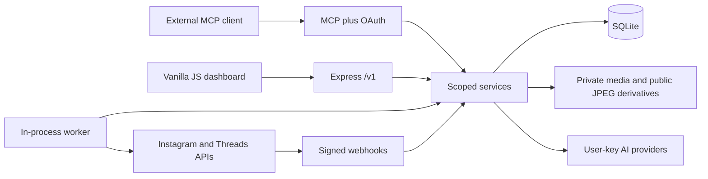

# Architecture and source map

## Runtime

Single Node.js 22.5+ ES-module application: Express 5, built-in `node:sqlite`,
Sharp and optional ffmpeg. Frontend is vanilla JavaScript served by the same app.
Worker polling runs inside this application process. There is no required Redis,
Postgres, Temporal, React or ComfyUI service in this repository. The node-canvas
experience is application UI, not a separate ComfyUI installation.

## Active frontend modules

| Source | Responsibility |
|---|---|
| `public/app.js` | Application shell, auth, hash routing and workspace dispatch; also contains older implementations |
| `public/ui.js` | Shared dialogs, chips, scope controls, autosave, grouping/format helpers |
| `public/icons.js` | SVG icons |
| `public/strings.id.js`, `public/strings.en.js` | Current Indonesian UI copy and existing translation helpers |
| `public/generator-workspace.js` | Campaign/Storyline form, model drawer, quick ideas, progress and generation submission |
| `public/content-workspace.js` | Draft session list/detail, concept/image review and session-calendar presentation |
| `public/home-workspace.js` | H1 dashboard with scoped summary and polling cleanup |
| `public/workspace-pages.js` | Calendar, media, insights and team page factory; delegates Home, Accounts/Brand Kit and Audit |
| `public/account-brand-workspace.js` | Company/accounts and account Brand Kit/Story Bible/memory detail |
| `public/story-memory.js` | Shared named-memory picker and session mutations |
| `public/audit-workspace.js` | Audit filtering, human-readable events, CSV |
| `public/workflow-canvas.js` | Workflow canvas UI |
| `public/*fidelity.css`, `public/index.html` | Page styling and stylesheet order |

Do not change a legacy function just because its name matches the requested page.
Trace the current dispatch in `app.js` and delegated factories first. Some older
functions and `public/story-workspace.js` remain for historical/other call paths.

## Backend modules

| Source | Responsibility |
|---|---|
| `src/server.js` | Express app, auth endpoints, health, public media, social connect/callback and worker startup |
| `src/config.js` | Configuration/env parsing, public URL, data directory, Meta settings |
| `src/auth.js`, `src/services/scope.js` | Sessions, machine auth and company/account authorization |
| `src/routes/api.js` | REST wiring and dashboard-only `sessionOnly` boundaries |
| `src/routes/oauth.js`, `src/mcp.js` | LRMsmm OAuth/MCP, personal draft handoff and distinct Owner automation |
| `src/services/generator.js` | Provider settings/keys, planning, production stages, quick ideas, review, retries and approval |
| `src/services/storytelling.js` | Account foundations/catalog, named memory, storyteller/manager/scheduler jobs |
| `src/services/brand-metadata.js` | Structured identity and labeled asset metadata |
| `src/services/brand-asset-policy.js` | Mandatory identity/product preservation policy |
| `src/services/protected-composition.js` | Original-source overlay placement after background generation |
| `src/services/visual-context.js` | Authorized Meta feed thumbnails; constrained CDN fetch, cache and availability reporting |
| `src/llm/providers.js` | OpenAI, Anthropic and Gemini adapters, model/schema/image request handling |
| `src/services/media.js` | Uploads, JPEG derivatives, retained private PNGs, ownership, use checks and GC |
| `src/services/posts.js`, `src/worker.js`, `src/meta/` | Publishing, polling, retries, synchronization and Meta adapters |
| `src/services/dashboard.js` | Home summary and durable Owner reconnect requests |
| `src/services/calendar-workspace.js` | Move/retarget conflict checks and private duplication |
| `src/services/audit-workspace.js` | Scoped audit data and export support |

## Persistence and ownership

`src/db.js` creates the schema and performs compatibility migrations on startup.
The default database is `DATA_DIR/lrmsmm.db`; media lives under `DATA_DIR/media`.
Preserve the existing encryption key when moving/restoring data.

| Tables/fields | Meaning |
|---|---|
| `users`, `sessions` and OAuth/API-key tables | User identity and distinct credential lifecycles |
| `companies`, `user_companies`, `accounts`, `user_accounts` | Company membership plus direct account grants |
| `posts`, `post_targets` | A post and independently succeeding/failing social targets |
| `media` | Public derivative path plus private `source_path`/`source_size_bytes` for new PNG uploads |
| `generator_plans`, `generator_runs` | Private production proposals, stages, source references, versions and approval linkage |
| `account_story_profiles`, `account_brand_assets` | Shared account foundation and pinned asset catalog |
| `story_memory_sessions` | Authoritative selected continuity: title, Bible, memory, next episode |
| `story_jobs`, `story_episodes` | Production history linked to a memory session; global vs session episode numbering |
| `conversations`, `comments`, `insights_daily` | Synchronized interactions and historical metrics |

Sessions are not generator plans: a named memory session can be continued through
several production jobs/plans. `story_jobs.memory_session_id` and
`story_episodes.memory_session_id/session_episode` keep continuity separate.
Legacy account memory migrates once to a session; compatibility profile summary
fields must not resurrect deleted sessions.

## Production sequence

Campaign: plan ideas → planned runs → concept → revision → concept review →
visual concept → image background → original asset composition → final QC → image
review → final approval → scheduled post/targets → worker → real Meta result.

Storyline first runs Storyteller → Manager → Scheduler against the chosen memory
session, creates proposed content and commits that session's continuity. Production
can then use the same content stages. A memory episode may describe a draft; agents
must not treat it as already published. Image/source paths and provider keys are
not public API payloads.
